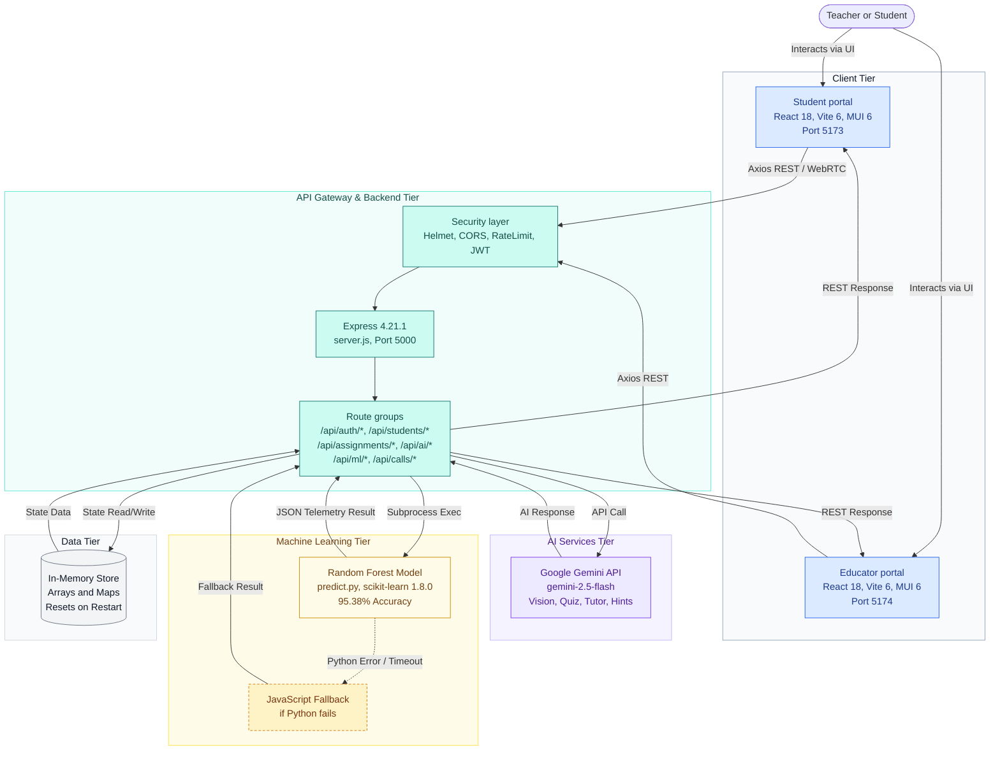

# MathLingo-AI (TutorMind)

**MathLingo-AI (TutorMind)** is an enterprise-grade, AI-powered adaptive mathematics learning platform and real-time virtual tutoring suite. Designed for K-12 and higher education institutions, it combines real-time WebRTC video collaboration, collaborative digital whiteboards, generative AI math problem-solving & adaptive quizzes, and a trained machine learning predictive engine to detect student cognitive struggle before academic failure occurs.

---

## 🌟 Key Features

### 1. Intelligent Student Portal
- **Interactive Math Solver & KaTeX Renderer**: Step-by-step mathematical problem solving with rich LaTeX math typesetting.
- **AI Vision & Adaptive Quizzes**: Optical math problem interpretation via Gemini AI vision endpoints and dynamic quiz generation tailored to individual skill levels.
- **Real-Time WebRTC Video Tutoring**: Peer-to-peer and student-to-educator video/audio calls with live signaling and ping monitoring.
- **Collaborative Whiteboard**: Real-time multi-user vector stroke synchronization, shape rendering, and instant canvas clearing over REST/polling signaling.
- **Personal Performance Analytics**: Recharts-powered progress dashboards tracking accuracy rates, streak retention, and topic mastery tiers.

### 2. Comprehensive Educator Portal
- **Classroom Roster & Progress Management**: Live student roster tracking, performance metrics, and assignment status monitoring.
- **Assignment Builder & Submissions Grading**: Create, distribute, and grade assignments with rich feedback and score tracking.
- **ML Cognitive Struggle Alerts**: Real-time monitoring of student struggle risk scores powered by machine learning inference.
- **Live Office Hours & Session Controls**: Coordinate virtual study sessions and monitor active video calls across the classroom.

### 3. Machine Learning Predictive Engine (`ml_service/`)
- **Random Forest Classifier**: Trained on student behavioral telemetry (`model_metrics.json`: **95.38% Accuracy**, **0.9942 ROC-AUC**, **0.9641 F1-Score**).
- **Explainable AI Feature Importance**:
  - **Consecutive Error Velocity** (40.15% weight)
  - **AI Tutor Inquiries** (31.74% weight)
  - **Recent Assessment Accuracy** (13.12% weight)
  - **Solving Latency / Pacing Ratio** (11.92% weight)
  - **Engagement & Retention Streak** (1.93% weight)
  - **Curriculum Topic Complexity Tier** (1.15% weight)
- **Cognitive State Classification**: Automated categorization into *Mastery Flow* (< 35%), *Steady Progress* (35% - 65%), or *High Struggle Risk* (>= 65%) with targeted pedagogical intervention recommendations (`isAtRisk` when >= 50%).

### 4. Robust Backend API (`backend/`)
- **Node.js & Express REST API**: Built with clean MVC architecture and ES Modules (`backend/src/server.js`).
- **Database Layer**: In-memory store implementation (`backend/src/server.js`). Note: Mongoose is listed in `backend/package.json` but unused in `server.js`.
- **Security & Hardening**: JWT Authentication (`jsonwebtoken`), password hashing (`bcryptjs`), security headers (`helmet`), rate limiting (`express-rate-limit`), and CORS protection.

---

## 🏛️ System Architecture


*Architecture Legend: Client Tier (Blue), Backend & Gateway (Teal), AI Services (Purple), Machine Learning Tier (Yellow/Gold), Data Tier (Gray).*

---

## 📂 Project Structure

```text
MathLingo-AI/
├── package.json              # Root workspace orchestration scripts
├── README.md                 # Project documentation
├── backend/                  # Node.js & Express REST API backend
│   ├── package.json
│   ├── .env.example
│   └── src/
│       ├── server.js         # Main Express server & API route handlers
│       ├── models/           # Mongoose database schemas
│       └── middleware/       # Auth and validation middleware
├── frontend/                 # React 18 & Vite frontend application
│   ├── package.json
│   ├── vite.config.js
│   ├── index.html
│   ├── educator-portal.html  # Dedicated educator dashboard entry
│   └── src/                  # React components, contexts, and API clients
└── ml_service/               # Python machine learning inference service
    ├── predict.py            # CLI & Python prediction runner
    ├── train_model.py        # Model training & cross-validation script
    ├── model_metrics.json    # Saved model evaluation metrics & feature weights
    └── struggle_model.joblib # Serialized Random Forest classifier
```

---

## 🚀 Getting Started

### Prerequisites
- **Node.js** (v18+ recommended)
- **Python 3.8+** (with `scikit-learn`, `pandas`, `numpy`, `joblib`)
- **MongoDB / In-Memory Mode** (App runs fully in-memory with arrays/maps; Mongoose optional)

### Installation

1. **Clone the Repository**:
   ```bash
   git clone https://github.com/akshay9128/MathLingo-AI.git
   cd MathLingo-AI
   ```

2. **Install All Dependencies (Root Workspace)**:
   ```bash
   npm run install:all
   ```
   *(Or install manually: `npm install --prefix backend` and `npm install --prefix frontend`)*

3. **Configure Environment Variables**:
   Copy `backend/.env.example` to `backend/.env` and update values if needed:
   ```bash
   cp backend/.env.example backend/.env
   ```

4. **Run Development Servers**:
   Run backend, student portal, and educator portal concurrently:
   ```bash
   npm run dev
   ```
   - **Student Portal**: `http://localhost:5173`
   - **Educator Portal**: `http://localhost:5174`
   - **Backend API**: `http://localhost:5000`

---

## 🔌 API Endpoints Summary

| Method | Endpoint | Description |
| :--- | :--- | :--- |
| `POST` | `/api/auth/register` | Register a new user (student/educator) |
| `POST` | `/api/auth/login` | Authenticate user and issue JWT token |
| `GET` | `/api/students/roster` | Retrieve student roster and performance metrics |
| `GET` | `/api/assignments` | List class assignments and active quizzes |
| `POST` | `/api/assignments/submit` | Submit assignment solutions and update telemetry |
| `POST` | `/api/ai/vision` | Optical math problem interpretation & solving |
| `POST` | `/api/ai/quiz/generate` | Generate adaptive AI practice quizzes |
| `POST` | `/api/ml/predict-struggle` | Predict student cognitive struggle risk via Random Forest |
| `POST` | `/api/calls/start` | Initialize WebRTC virtual tutoring call session |
| `GET` | `/api/calls/:id/whiteboard` | Fetch real-time collaborative whiteboard vector strokes |
| `POST` | `/api/calls/:id/whiteboard` | Push whiteboard vector stroke updates |

---


